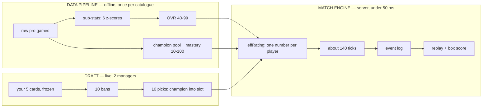
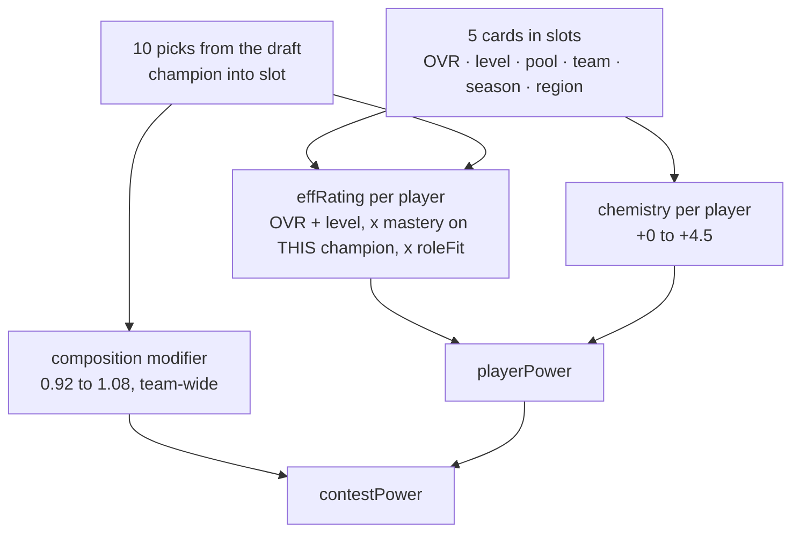
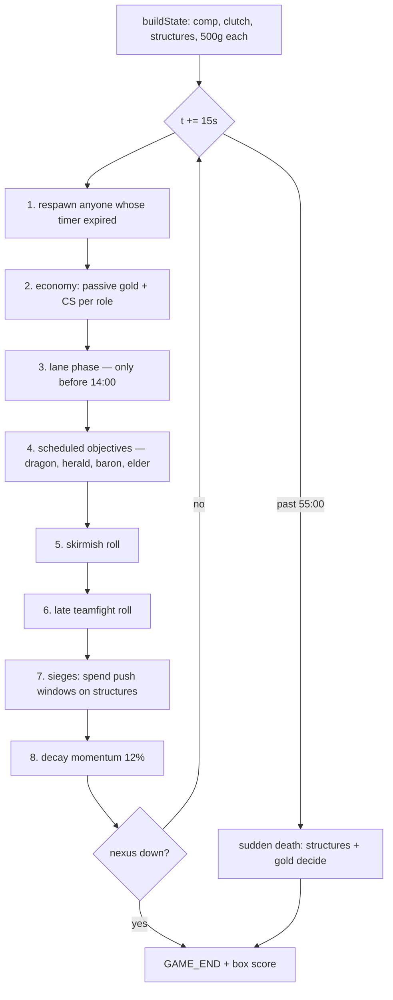
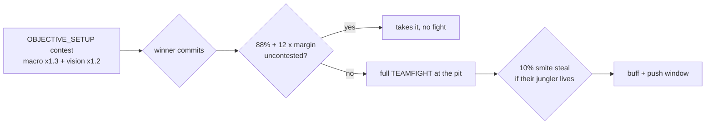

# 13 — How the engine works

An explainer, not a specification. Everything here describes the code that is actually
running, with the numbers read out of it. Where it disagrees with docs/02 or docs/04, the
disagreement is noted and this file is right — see [section 7](#7-known-drift-from-the-specs).

Every number below was produced by running the shipped code against `data/catalogue.json`
(3,730 cards, seasons 2014–2026). Nothing is illustrative.

---

## 0. The shape of the whole thing

There are two engines, and exactly one number passes between them.



**The one number is `effRating`.** The match engine never sees a card, a rarity, a portrait or
an OVR. It sees ten players, each with one rating, six sub-stats and a champion. Everything the
collection and the draft do, they do by moving that one number.

---

## 1. The card: OVR and mastery measure different things

This is the part that confuses everyone, including the question that prompted this file:
*why is a 76 OVR card sitting at 50 mastery on its best champion?*

Because the two numbers answer different questions.

| | OVR | mastery |
|---|---|---|
| asks | **How well did they play?** | **How much did they play _this champion_?** |
| scale | 40–99, one per card | 10–100, one per champion in the pool |
| reads | per-game performance, ranked against everyone else in that role and season | games played on that champion, adjusted by win rate and on-champion form |
| ignores | how many games they played | how good the player is |

They are nearly independent by construction. Measured across the whole catalogue:

```
correlation(total games played, best mastery)  =  0.79    <- mastery is mostly games
correlation(OVR,                best mastery)  =  0.59
```

### 1.1 Where OVR comes from

`scripts/build-catalogue.mjs`, four steps:

```
1. cohort      every player in the same (role, season)

2. sub-stats   6 measured metrics -> z-score inside that cohort -> round(50 + 14z), 1..99
               laning · teamfight · mechanics · macro · vision · consistency

3. raw OVR     role-weighted sum of the six
                 + accolade bonus     (titles and finals, capped)
                 + region adjustment  (how strong that league was that season)
                 + career lift        (a season is pulled up toward the best standing the
                                       player had already earned, fading per year)

4. final OVR   every raw OVR in the catalogue is ranked, and the percentile is mapped onto
               the docs/02 band shares
```

Step 4 is why OVR is a **rank**, not a measurement:

| band | share of catalogue | OVR range |
|---|---|---|
| COMMON | 45.0% | 40–67 |
| RARE | 30.0% | 68–76 |
| EPIC | 17.0% | 77–84 |
| LEGENDARY | 6.5% | 85–91 |
| ICON | 1.5% | 92–99 |

A 76 OVR card is therefore "better per game than about 75% of the catalogue". It says nothing
whatsoever about how many games there were.

### 1.2 Where mastery comes from — the answer to the question

`scripts/build-catalogue.mjs` → `championPool()`, and docs/03 §7:

```
base    = 100 * games / (games + 6)
wrAdj   = (winrate - 0.50) * 40                          # +/-20 at the extremes
perfAdj = clamp(z(form on this champ vs own season) * 8, -12, +12)

mastery = round(clamp(base + wrAdj + perfAdj, 10, 100))
```

**`base` is the whole story.** It is a saturating curve on games played and nothing else:

```
 games:    2     3     4     6    10    12    15    20    30    50
 base:    25    33    40    50    62    67    71    77    83    89

 100 |                                        ......-----''''''
     |                             ....----''''
  75 |                     ...--''''                    <- 20 games
     |              ..-''
  50 |        ..-''                                     <- 6 games
     |     .-'
  25 |  .-'                                             <- 2 games (minimum to appear)
     | /
   0 +-------------------------------------------------------
       0      10      20      30      40      50   games on this champion
```

To reach mastery **70** — `DEPTH_MASTERY` in `shared/roster.ts`, the threshold the Team screen
calls a real champion — a player needs roughly **15 games on one champion in one season at a
50% win rate**. Fewer games, or a losing record, and it does not get there.

So a 76 OVR card with a 50-mastery best champion is a player who:

- played a **wide, shallow pool** — a flex pick who rotated through eight champions, or
- played a **short season** — a substitute, a mid-split call-up, a rookie with 15 games, or
- **lost** on their most-played champion (a 33% win rate is −6.7 mastery on its own).

They were good *per game*. They were never on one champion long enough to main it. That is a
true fact about that player's season, and the card is reporting it correctly.

### 1.3 It is common, not an edge case

Best mastery per card, across all 3,730:

```
   0-19  |                                                      3
  20-39  | ##                                                  85
  40-59  | ################                                   724   <- your 76 / 50 card
  60-79  | ##########################################        1887
  80-99  | #######################                           1024
    100  |                                                      7
```

**22% of the catalogue has no champion above mastery 59.** The average card has 9.9 champions
in its pool but only **1.35** of them at mastery 70 or better. A deep pool is the rare thing,
not the default.

### 1.4 effRating: the only number the match reads

`packages/core/src/index.js`:

```
levelBonus(level)  = min(3.6, 0.4 * (level - 1))

masteryFactor(m)   = 0.70 + 0.30 * (m / 100)

roleFit(role,slot) = 1.00   the champion's own role
                   = 0.90   adjacent (TOP<->JNG, JNG<->MID, BOT<->SUP)
                   = 0.72   anything else

effRating = clamp( (OVR + levelBonus) * masteryFactor * roleFit , 30 , 99 )
```

The mastery curve, which is where a card's real power lives:

```
 mastery:     0     20     40     60     70     80    100
 factor:  0.700  0.760  0.820  0.880  0.910  0.940  1.000

 1.00 |                                              ....---'
      |                                 ....---''''''
 0.85 |                    ....---''''''
      |       ....---''''''
 0.70 |--''''
      +-------------------------------------------------------
        0      20      40      60      80     100    mastery
```

A straight line, on purpose. It shipped for a while with a `^0.75` exponent, which bent
the curve upward and made the first 40 points of mastery nearly free — see
[section 7](#7-known-drift-from-the-specs).

Note the floor: **mastery 0 is still 0.70, never zero.** A card handed a champion it has never
touched loses 30%, which hurts but is survivable. That floor is deliberate (docs/02 §7) — it is
what stops a well-aimed ban from deleting a player outright.

### 1.5 The two cards, worked through

Two real cards from the catalogue, one OVR point apart, both playing their own best champion in
their own role:

| | `zorah-2022` | `bdd-2023` |
|---|---|---|
| OVR | 75 (SUP) | 74 (MID) |
| best champion | Braum — **3 games, 33%** | Azir — **27 games, 82%** |
| mastery there | **28** | **97** |
| masteryFactor | 0.784 | 0.991 |
| **effRating at level 1** | **58.8** | **73.3** |
| effRating at level 10 | 61.6 | 76.9 |

**A 14.5-point gap between two cards with the same OVR.** For scale, the balance harness in
[section 5](#5-who-wins) measures a +5 effRating squad edge as worth 57.8% of matches. This gap
is nearly three times that, on one player, from an identical OVR.

### 1.6 How to read a card in one second

> **OVR is the headline. The pool is the card.**
>
> Look at the games column, not the rating. Two or three champions at 15+ games is a card you
> can field all season. A 90 OVR with nothing above 6 games is a trophy, not a starter.

Three consequences worth internalising:

| the card | the champion it gets | plays at |
|---|---|---|
| 92 OVR | never played it (mastery 0) | **64.4** — bottom tier |
| 92 OVR | mastery 70 | **83.7** |
| 92 OVR | mastery 70, **off-role** | **60.3** — worse than never playing it in lane |
| 78 OVR | its 95-mastery main | **76.8** |

So the real crossover is not between a great card and a good one — it is between *mastered* and
*not*. Being handed the wrong champion costs more than twenty OVR points of card quality.

---

## 2. Five cards into ten numbers

Between the draft ending and the engine starting, `server/utils/duelRun.ts` → `finish()` turns
each side into five players. Three things are added on top of `effRating`.



**Chemistry** (`shared/roster.ts` → `chemistryFor`) is a flat addition to a player's rating:

| condition | bonus each |
|---|---|
| two cards shared a real team in the same season | +1.5 |
| three or more such cards | +2.5 (does not stack with the above) |
| all five from the same region | +1.0 |
| all five from the same season year | +1.0 |

Capped at **+4.5** per player, which is less than one mastery tier. Chemistry is flavour, not a
build-around — that cap is the design saying so.

**Composition** (`packages/sim/src/champions.js` → `compositionFor`) scores the five *champions*,
not the cards, and multiplies the whole team's power:

| factor | good | bad |
|---|---|---|
| frontline count | 2 → +0.03 | 0 or 4+ → −0.03 |
| hard engage | +0.02 | −0.02 |
| peel for the carry | +0.015 | −0.015 |
| AoE for teamfights | 2+ → +0.02 | 0 → −0.01 |
| mixed AD/AP damage | +0.015 | one type → −0.015 |

Clamped to **0.92 … 1.08**. The full 16-point swing is worth roughly as much as a 5-point rating
edge, which is why the balance harness measures "draft edge only" as a separate row.

**Archetype curves.** The champion also decides *when* a player is strong
(`BALANCE.phaseCurve`), which is what makes the draft about more than one number:

| archetype | EARLY (<14:00) | MID (<25:00) | LATE | gold leverage |
|---|---|---|---|---|
| LANE_BULLY | **1.12** | 1.00 | 0.90 | 1.0 |
| SKIRMISHER | 1.06 | 1.04 | 0.94 | 1.05 |
| ASSASSIN | 1.00 | **1.10** | 0.95 | 1.2 |
| TANK | 0.95 | 1.05 | 1.05 | 0.6 |
| UTILITY | 0.98 | 1.02 | 1.02 | 0.7 |
| SCALING_CARRY | 0.86 | 1.02 | **1.18** | **1.3** |

A scaling carry is 37% stronger at 30 minutes than at 10. Picking one is a bet that the game
goes long — and `SCALING` strategy is the bet doubled.

---

## 3. The match engine

`packages/sim/src/index.js`. Pure, deterministic, no clock and no `Math.random`: the same input
and seed produce the same event log on the server, in a test and in the tuning harness. That is
what makes a replay a *record* rather than a re-enactment.

### 3.1 The tick loop

A tick is **15 game-seconds**. A 35-minute game is 140 ticks. The hard stop is 55 minutes.



Every tick does the same eight things in the same order. All of the interesting behaviour lives
in the modules it calls, so the order of random draws — which is the whole of determinism — is
readable on one screen.

### 3.2 One function decides everything

Every single thing in the engine that can go either way goes through `resolve()` in
`packages/sim/src/power.js`. There is exactly one place where "a better squad wins more".

```
                        for each player in the contest
                        ------------------------------
playerPower(p)     =  (effRating + chemistry)
                      x phaseCurve[archetype][phase]        <- when this champion is strong
                      x (1 + goldFactor)                    <- how fed, x archetype leverage
                      ... and 0 if dead

                        for the side as a whole
                        -----------------------
contestPower(side) =  mean( playerPower x subStatWeight )   <- MEAN, not sum
                      x comp.modifier                       <- 0.92 .. 1.08
                      x strategy[kind][phase]               <- STANDARD / AGGRESSIVE / SCALING
                      x coach[kind][phase]
                      x (1 + momentum x 0.05)
                      x (1 + buffs)                         <- dragons, soul, elder, baron

                        the coin flip
                        -------------
d        = attackerPower - defenderPower
kEff     = 1.0 x (0.75 + 0.5 x meanConsistency / 99)
pWin     = clamp( 1 / (1 + exp(-kEff x d / 98)) , 0.08 , 0.92 )
```

Four things in that block matter more than the rest:

1. **It is the mean, not the sum.** A 5v3 is not won by arithmetic. Being outnumbered costs you
   because dead players contribute zero *everywhere else*, not because of a headcount here.
2. **`subStatWeight` measures specialisation,** as a ratio against the player's own average. A
   70-rated laner who is all `laning` is better in lane than a 70-rated generalist, and worse in
   a teamfight. This is what makes sub-stats worth reading.

   | contest kind | weighted stat |
   |---|---|
   | `LANE` | laning ×1.4 |
   | `GANK` | mechanics ×1.2, vision ×1.2 |
   | `SKIRMISH` | mechanics ×1.3 |
   | `TEAMFIGHT` | teamfight ×1.3 |
   | `OBJECTIVE_SETUP` | macro ×1.3, vision ×1.2 |
   | `SIEGE` | macro ×1.2 |

3. **The 8% / 92% clamp is the most important line in the engine.** No contest is ever a
   formality, however stacked the collection. The underdog always has a story.
4. **Consistency flattens the curve, it does not shift it.** It multiplies `kEff`, so a steady
   team swings less in both directions. Consistency buys reliability, never free wins.

The scale is deliberately gentle. `sigma = 98` means a rating edge converts to a *contest* edge
very slowly:

| squad rating edge | chance of winning **one contest** |
|---|---|
| +0 | 50.0% |
| +2 | 50.5% |
| +5 | 51.3% |
| +10 | 52.7% |
| +20 | 55.4% |
| +40 | 60.6% |
| +80 | 70.3% |

A match contains dozens of these, plus the gold and momentum feedback loops, which is how a
51.3% contest edge becomes a 57.8% match edge. See [section 5](#5-who-wins).

### 3.3 The five ways a contest happens

```
     00:00                        14:00                 25:00              55:00
       |------- EARLY --------------|------ MID ----------|----- LATE -------|
       |                            |                     |
 LANE  |####### pressure, plates, turret, ganks #####|     (lane phase ends at 14:00)
       |
 OBJ   |     dragon 5:00, then every 5:00 · herald 14:00 · baron 20:00 · elder after soul
       |
 SKIRM |##### 2.8%/tick ############|#### 3.2%/tick #####|### 2.0%/tick ####|
       |
 TFIGHT|         (none)             |#### 1.5%/tick #####|### 6.8%/tick ####|
       |
 SIEGE |############ every tick, spending whatever fights banked ##########|
```

**Lane phase** (`lane.js`) — the only channel with memory. Pressure is an accumulator, not a
coin flip, which is what makes a lane lead *feel* like a lead:

```
 per tick, per lane:
   edge      = tanh( (bluePower - redPower) / 18 )      <- saturates on purpose
   pressure += edge * 0.95

 pressure >= 10  ->  take a plate, pressure *= 0.45   (5 plates max, gone at 14:00)
 pressure >= 18  ->  take the outer turret, pressure = 0
```

The `tanh` is load-bearing. With linear pressure a +20 squad took plates four times faster than
a +5 squad and the win matrix read 84% where it wanted 75%. Lane income in a real game
saturates — there are five plates and one outer turret — so a much better laner wins *the lane*,
not twenty lanes.

Ganks ride on top: the jungler goes where the pressure is worst for their team (losing lanes get
ganked more, which is both realistic and what a player expects), modified by their `macro`. A
successful gank is worth **19 pressure** — more than a plate. A failed gank gives that 19 to the
lane that read it, which is what `vision` buys.

**Objectives** (`objectives.js`) resolve in three steps, in the tick the objective spawns:



Winning the setup — before a single sword is drawn — is usually enough. That is what macro and
vision are *for*, and it is why an ace before a baron spawn is worth so much: with one side
wiped, the objective is simply taken.

**Fights** (`combat.js`) resolve to a *margin*, not a binary. This is where most games are
actually decided:

```
margin        = |pWin - 0.5|
loserDeaths   = round( 0.90 + 6 * margin + rand )     clamped 0..5
winnerDeaths  = round( 1.35 - 3 * margin + rand )     clamped 0..4
```

A fight won on the edge costs the winner two or three bodies and buys nothing. A fight won
decisively is a 4-for-0. Who dies is **inverse power weighted**, exponentially:

```
weight(p) = exp( -22 * (playerPower(p) / meanPower - 1) )
```

Your weakest starter dies most often. That is deliberately the most legible feedback in the
whole engine: a manager who sees their 61-rated support on eight deaths knows exactly what to
fix, and no other screen tells them that. The harness holds the best player to **56.1%** of the
worst player's deaths.

### 3.4 How a game actually ends

This is the hinge of the whole engine, and the part nobody guesses: **kills do not win games,
respawn timers do.**

```
a won fight:
   netBodies      = loserDeaths - winnerDeaths
   pushOpportunity += netBodies x respawnTime(t) x 0.34     <- seconds of enemy absence
   an ace adds the full mean respawn window x 1.15

every tick:
   effective = pushOpportunity
               x 1.60 if baron        <- the real reason baron matters
               x 1.35 if elder
               x (0.45 .. 1.55)       <- jitter, so games do not all end at once

   structures taken = floor( effective / 47 )               <- 47 seconds = one structure
   pushOpportunity  = 0                                     <- unspent windows do not bank
```

A worked example at 25 minutes, where a respawn is 43 seconds:

```
 win a fight 4-1  ->  netBodies 3
                      3 x 43 x 0.34            = 43.9 seconds of push
                      x 1.60 with baron        = 70.2
                      70.2 / 47                = 1 structure
```

So a clean fight plus baron is worth about one turret. Two uncontested aces end a game. And a
team that wins every fight 3-for-2 wins nothing at all — which is exactly the 40-minute
stalemate that real games produce.

Structures fall outside in, on the lane that is already furthest in:

```
 each lane:  outer turret -> inner turret -> inhibitor turret -> inhibitor
 then:       2 nexus turrets (need an inhibitor down first)
 then:       nexus                                            -> GAME OVER
```

If nothing resolves by 55:00, `suddenDeath()` scores standing structures plus gold per thousand
and declares a winner. It fires in **0.1%** of games — and if that number ever rises, siege
conversion is mistuned and sudden death is the symptom, not the problem.

### 3.5 The feedback loops

Three loops make a lead real without making it absolute. Each one has a brake.

| loop | how it amplifies | the brake |
|---|---|---|
| **gold** | kills and structures → `goldFactor` → more power | clamped −0.35 … +0.45, and scaled by archetype (tank 0.6×, scaling carry 1.3×) |
| **momentum** | winning a fight → +0.18, up to ±1 → ×0.05 power | decays **12% every tick** |
| **map** | push windows → structures → gold → more power | structures are finite; plates expire at 14:00 |

This is why killing the *right* person matters: a fed assassin converts gold at 1.2× and a fed
tank at 0.6×.

---

## 4. The box score and grades

`packages/sim/src/boxscore.js`. CS is a per-role ledger (minions and camps only, nothing while
dead), not read back out of gold — otherwise every kill turned into creeps and supports finished
on twenty a minute.

The grade is the emotional point of the screen, and it is **a grade against expectation, not
against output**:

```
score = 0.90 x zScore(how well they played their role, across the ten on the map)
      + 0.36 x (their team won ? +1 : -1)
      - 0.30 x zScore(their effRating, across the ten)     <- the better card must do more

 S+ > 1.75    S > 1.10    A > 0.45    B > -0.45    C > -1.10    D otherwise
```

"How well they played their role" is itself measured against what the role normally does, so a
support's 2/3/18 and a carry's 9/2/5 can land in the same place:

| role | expected CS/min | weighted on |
|---|---|---|
| TOP | 7.6 | KDA, damage, some CS |
| JNG | 5.8 | kill participation ×1.2, KDA |
| MID | 8.7 | damage ×1.1, KDA |
| BOT | 9.0 | damage ×1.1, CS |
| SUP | 1.25 | kill participation ×1.5, vision ×0.6 |

The `- 0.30 x zScore(effRating)` term is the whole design: grading raw stats would hand every S
to whoever was already the best card, which nobody needs a scoreboard to learn. A 61-rated
support who held a game together out-grades the 85 beside them.

---

## 5. Who wins

`npm run sim:balance` — 4,000 simulations per row, run against the current code:

```
  target                             value   window
  --------------------------------------------------------------
  Win rate, equal squads             49.0%   49-51%          pass
  Win rate, +5 effRating             57.8%   56-59%          pass
  Win rate, +10 effRating            63.1%   62-66%          pass
  Win rate, +20 effRating            73.5%   72-78%          pass
  Win rate, draft edge only          56.5%   55-58%          pass
  Mean game length               32.28 min   31-34 min       pass
  Game length stddev              6.35 min   5-7 min         pass
  Decided before 20:00                0.0%   0-8%            pass
  Sudden death rate                   0.1%   0-1%            pass
  Mean kills per game                28.68   22-30           pass
  First-blood team win rate          56.4%   56-62%          pass
  Best/worst player deaths           56.1%   0-60%           pass
```

Read that top block as the answer to "does my collection decide the season?":

```
 squad edge     one contest     the match       what it means
 ----------     -----------     ---------       -------------
   +0              50.0%          49.0%         a coin flip
   +5              51.3%          57.8%         a clear but losable edge
  +10              52.7%          63.1%         you are the favourite
  +20              55.4%          73.5%         you should win 3 in 4 — not 9 in 10
```

**A +20 effRating squad — a gulf, far more than any realistic collection gap — still loses one
match in four.** That is the engine working as designed. The 8%/92% per-contest clamp, the
`tanh` saturation in lane, and the jitter on siege windows are all there to keep it that way.

Two more rows worth knowing:

- **Draft edge only: 56.5%.** With identical cards on both sides, winning the draft on
  composition alone is worth about as much as a +5 rating edge. The draft is not decoration.
- **First blood: 56.4%.** An early kill matters, through momentum and lane pressure rather than
  through its 300 gold. Kill gold alone never moved this off 50%.

---

## 6. Where to look in the code

| question | file |
|---|---|
| What is a card worth on a champion? | `packages/core/src/index.js` → `effRating` |
| Where did mastery come from? | `scripts/build-catalogue.mjs` → `championPool()` |
| Where did OVR come from? | `scripts/build-catalogue.mjs` → `ovrFromPercentile`, `BANDS` |
| What do my five cover between them? | `shared/roster.ts` → `coverageFor`, `banRisk` |
| Chemistry, best-five solver | `shared/roster.ts` → `chemistryFor`, `bestLineup` |
| Every tunable number | `packages/sim/src/balance.js` → `BALANCE` |
| How a contest resolves | `packages/sim/src/power.js` → `contestPower`, `resolve` |
| The tick loop | `packages/sim/src/index.js` → `simulate` |
| Lane pressure, plates, ganks | `packages/sim/src/lane.js` |
| Fights, deaths, assists | `packages/sim/src/combat.js` |
| Fights becoming structures | `packages/sim/src/structures.js` → `resolveSieges` |
| Grades | `packages/sim/src/boxscore.js` → `gradeRows` |
| Draft output into sim input | `server/utils/duelRun.ts` → `finish()` |

Two commands worth having in your fingers:

```bash
npm run sim:match -- --seed anything --quiet   # a text play-by-play of one game
npm run sim:balance                            # the matrix in section 5
```

---

## 7. Known drift from the specs

`masteryFactor` and `roleFit` used to be the interesting entries here. They have been
restored to the documented values in `packages/core/src/index.js`, so only one entry is
left — and it is a deliberate correction, not drift.

| | docs say | code does | effect |
|---|---|---|---|
| `sigma` | 3.6 (docs/04 §5.5) | **98** | the doc's arithmetic is wrong at this scale; `balance.js` says so in a comment and the fitted value is what passes the matrix |

### 7.1 What was restored, and what it changed

| | code did | code does | effect |
|---|---|---|---|
| `masteryFactor` | `0.70 + 0.30 * (m/100)^0.75` | `0.70 + 0.30 * (m/100)` — linear | low and mid mastery now cost what the spec says (m=40 → 0.820 not 0.851, m=70 → 0.910 not 0.930) |
| `roleFit` off-role | 0.88 | **0.72** | playing a champion out of its lane is a real penalty again |
| `roleFit` flex | 0.94 | 0.90 | adjacent lanes cost 10%, not 6% |

All three pushed the same way — **raw OVR mattered more and pool depth less** — which is
the inverse of the design goal docs/02 §2.4 states. The crossover it prints is a 92 OVR on
an unmastered champion against a 78 OVR on its main, and that one always held, because
`masteryFactor(0)` is 0.70 under either curve:

```
 92 OVR, mastery 0   ->  64.4
 78 OVR, mastery 95  ->  76.8      <- the documented crossover, 12.4 clear
```

What moved is the middle of the range, which is where real cards actually sit:

```
                        before      after
 92 OVR, mastery 40      78.3       75.4
 92 OVR, mastery 70      85.5       83.7
 78 OVR, mastery 95      77.1       76.8
```

Read as a break-even — the OVR a fully mastered card needs to match a 92 OVR handed a
champion at mastery *m*:

| the 92 OVR's champion | before | after |
|---|---|---|
| mastery 0 | 65 | 65 |
| mastery 40 | 79 | **77** |
| mastery 50 | 82 | **79** |
| mastery 70 | 87 | **85** |

So mastery buys a few more OVR points of deficit than it did, but **it is still a
tiebreaker between near-equals, not a way to field cheaper cards.** The multiplier spans
0.70–1.00; it can never cover a 20-OVR gap on its own. The lever that actually bit is
`roleFit`: a 92 OVR on a mastery-70 champion played out of its lane now lands at 60.3,
below the same card on a champion it has never touched in its own lane.

### 7.2 What this did not change

`npm run sim:balance` is identical to [section 5](#5-who-wins), row for row. That is
expected and worth stating plainly: the harness builds its squads by setting `effRating`
directly, so it never calls `masteryFactor` or `roleFit` at all. **These constants decide
what a collection is worth; the harness only measures what a rating edge is worth once you
have it.** Nothing in section 5 is evidence either way about this change.

### 7.3 What it did to the catalogue

Measured over all 3,730 cards, each on its own best champion in its own role:

```
 mean effRating        62.11  ->  60.94      (-1.17, and 99.8% of cards moved down)
 corr(effRating, OVR)   0.992 ->   0.988
 corr(effRating, m)     0.685 ->   0.702
```

The deflation is uniform and lands on both sides of every match, so it decides nothing by
itself. **The spread inside an OVR band is the number that matters,** because that is
"two cards you would call equally good, separated by their pools":

| OVR band | cards | effRating spread before | after |
|---|---|---|---|
| 68–76 (RARE) | 1,119 | sd 3.27, range 18.7 | sd **3.57**, range **20.6** |
| 77–84 (EPIC) | 635 | sd 3.03, range 17.2 | sd **3.38**, range **19.5** |
| 85–91 (LEGENDARY) | 243 | sd 2.60, range 12.4 | sd **2.94**, range **14.1** |

About 11% more spread in every band. That is the design goal moving in the right
direction, and it is honest to say it is a nudge rather than a reversal — OVR still
correlates with effRating at 0.988, because OVR is still the multiplicand.

The thing to watch instead is draft behaviour against the real catalogue — whether bans
now bite, and whether the Team screen's `DEPTH_MASTERY` threshold of 70 still names the
right cards. See docs/10 §4 and the follow-up work on fearless drafting.
